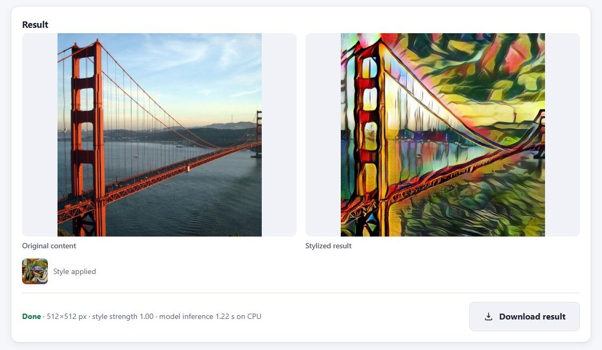
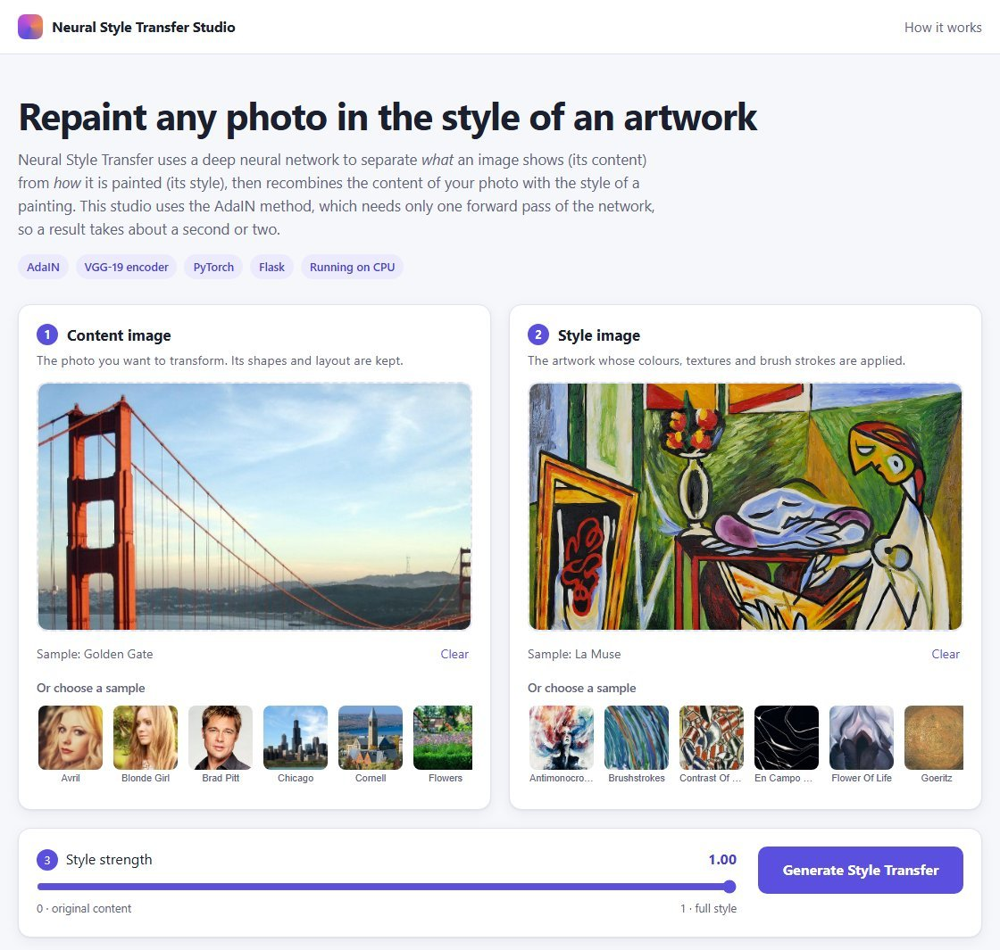
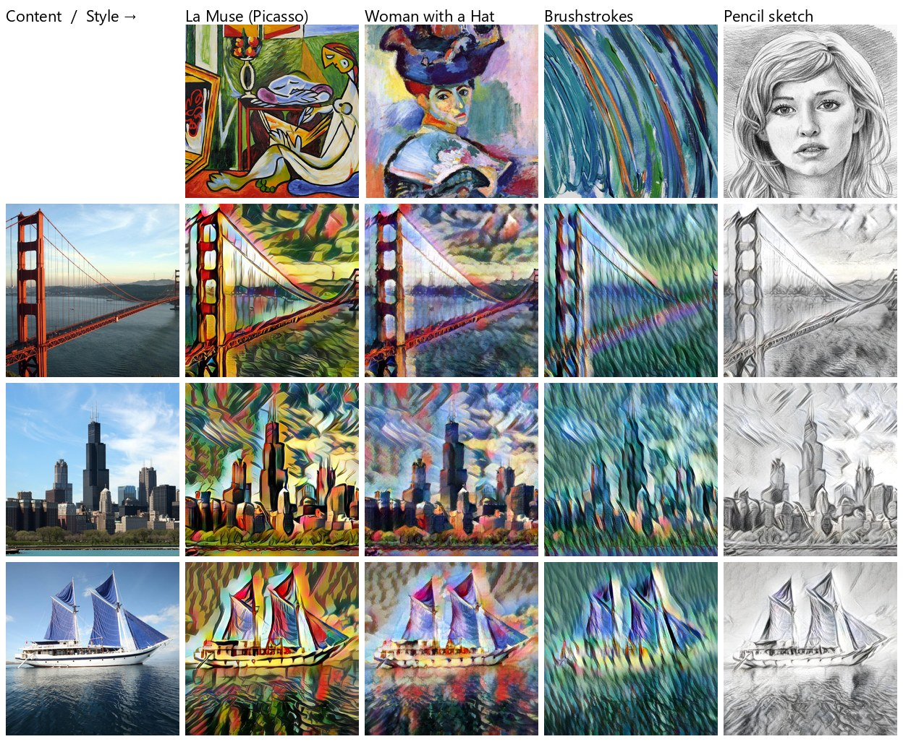
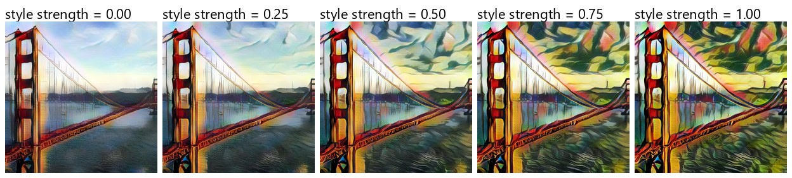

# Neural Style Transfer Studio

A web application that repaints any photo in the style of an artwork using **AdaIN** (Adaptive Instance Normalization) neural style transfer. You upload a content photo (or pick a sample), choose a style image, set the style strength, and the app returns a stylized image in about a second on a laptop CPU. You can view it next to the original and download it.




---

## Problem statement and objectives

Classic neural style transfer (Gatys et al., 2016) optimizes every output image separately. That takes minutes per image and is impractical in an interactive app. AdaIN does style transfer in **one forward pass** for *any* style image. The original repository contained a working AdaIN model and a basic Flask page, but the app could not run outside the author's Linux machine and had no input validation.

Objectives of this project:

1. Make the existing model run reliably on a Windows laptop **without retraining it**.
2. Build a clean, responsive interface: upload or pick images, preview them, control the style strength, view results side by side, and download them.
3. Handle bad input safely (wrong formats, corrupted files, huge images, oversized uploads, tampered requests) with clear messages.
4. Separate configuration, inference and web code, and cover the important behaviour with automated tests.

## Features

- **Upload or choose a sample** for both the content image and the style image (11 sample photos and 19 sample artworks), with drag-and-drop and instant previews.
- **Style-strength slider** (α from 0 to 1). AdaIN supports this natively by blending style and content features.
- **Generate** button with a spinner and an elapsed-time counter. Requests run in the background (`fetch`), so the page does not reload.
- **Side-by-side comparison** of the original and the stylized result, plus the style used, the output size and the measured inference time.
- **Download** the result as a file (`stylized_image.jpg` or `.png`).
- **Validation with clear messages**: missing images, unsupported types, files that are not really images, truncated JPEGs, uploads over **10 MB**, images over **40 megapixels**, extremely long and thin images (sides differing by more than **4×**), and invalid style-strength values.
- **Safe file handling**: random unique filenames, uploads deleted straight after processing, results deleted after one hour, path-traversal protection and CSRF protection.
- **Responsive and accessible layout** with automatic light and dark mode. It works offline: there are no external CDNs or fonts.



## Example outputs

All images below were generated **by this app's own API** using the bundled samples.



**Style strength** blends the stylized features with the original content features. At α = 0 the decoder simply reconstructs the content features, which is why even that image looks slightly painterly:



## How Neural Style Transfer works (AdaIN)

A convolutional network trained for image recognition (VGG-19) learns features that describe images at different levels. Early layers respond to colours and textures, and deeper layers respond to shapes and objects. Huang & Belongie observed that the **mean and standard deviation of each feature channel** capture an image's *style*, while the **spatial arrangement** of the features captures its *content*.

```
 content image ─┐                                 ┌──────────────────┐
                ├─► VGG-19 encoder (to relu4_1) ─►│  AdaIN + α blend │─► decoder ─► stylized image
 style image  ──┘    512 feature maps each        └──────────────────┘
```

1. **Encode.** Both images are resized so the shorter side is 512 px and passed through the first layers of VGG-19 (up to `relu4_1`), producing 512 feature maps each. The encoder is pretrained and frozen.
2. **AdaIN.** Each content feature channel is normalized to zero mean and unit variance, then rescaled with the style's statistics:
   `AdaIN(c, s) = σ(s) · (c − μ(c)) / σ(c) + μ(s)`
3. **Blend.** `t = α · AdaIN(c, s) + (1 − α) · c`, where α is the style-strength slider.
4. **Decode.** A decoder, a mirror image of the encoder with upsampling layers, turns the features back into an image.

**Training (done by the original author, not in this project):** the decoder was trained to minimize a *content loss* (its output, re-encoded by VGG, should match the AdaIN features) plus a *style loss* (the mean and standard deviation of the output's VGG features at four layers should match the style image's). See `NST_Code/train.py` and `NST_Code/experiment/final_exp/options.txt`.

## Technologies

| Area | Technology |
|---|---|
| Model and inference | Python 3.11, PyTorch 2.2.2, torchvision 0.17.2 |
| Web backend | Flask 3.1, Flask-WTF (CSRF protection), Werkzeug |
| Image handling | Pillow 12 |
| Frontend | HTML, CSS and vanilla JavaScript (no framework, no CDN) |
| Testing | Python `unittest` and Flask's test client. The browser behaviour was also checked in headless Microsoft Edge (see [Testing](#testing)). |

## Project structure

```
NST_Project/
├── README.md
├── requirements.txt
├── docs/images/                 # README screenshots and example outputs
└── NST_Code/
    ├── app.py                   # Flask routes, validation, file handling
    ├── config.py                # paths, limits and settings (secret key from environment)
    ├── utils/
    │   ├── inference.py         # model loading and the style_transfer() pipeline
    │   ├── models.py            # VGG encoder and decoder architectures (original)
    │   └── utils.py             # AdaIN and mean/std helpers, dataset (original)
    ├── templates/index.html     # the web interface
    ├── tests/test_app.py        # 29 automated tests
    ├── train.py                 # decoder training script (original)
    ├── vgg_normalised.pth       # pretrained VGG-19 weights (78 MB)
    ├── experiment/final_exp/    # trained decoder (decoder_final.pth) and training samples
    ├── content_data/, style_data/   # sample images offered in the app
    └── runtime/                 # created at run time for uploads and results (git-ignored)
```

`NST_Code/examples/`, `NST_Code/static/uploads/` and `code.ipynb` come from the original repository and are not used by the app.

## Installation (fresh Windows machine)

**Requirements:** Windows 10 or 11, [Python 3.11 (64-bit)](https://www.python.org/downloads/), [Git](https://git-scm.com/download/win), and about 2 GB of free disk space (the virtual environment measured 1.3 GB and the project 0.3 GB). No GPU is needed. While running, the server used at most about 0.9 GB of RAM.

Run these in **PowerShell**:

```powershell
# 1. Download the project
cd $HOME\Documents
git clone <your-repository-url> NST_Project
cd NST_Project

# 2. Create and activate a virtual environment
py -3.11 -m venv .venv
.\.venv\Scripts\Activate.ps1
# If PowerShell blocks the script, run this once for the current window and try again:
# Set-ExecutionPolicy -Scope Process -ExecutionPolicy RemoteSigned

# 3. Install dependencies (PyTorch is about 200 MB, so this can take a while)
python -m pip install -r requirements.txt

# 4. Check the install
python -c "import torch; print(torch.__version__)"    # expected: 2.2.2+cpu
```

> **NVIDIA GPU (optional):** the default PyTorch package for Windows runs on the CPU only. For CUDA, install PyTorch from the [official selector](https://pytorch.org/get-started/previous-versions/) (for example, the CUDA 12.1 build of 2.2.2). The app uses the GPU automatically when `torch.cuda.is_available()` is true. GPU mode was **not tested** in this project.

## Running the app

From the project root, with the virtual environment active:

```powershell
python NST_Code\app.py
```

Open **http://localhost:5000** in your browser. Press **Ctrl+C** in the terminal to stop the server.

Optional environment variables:

| Variable | Purpose |
|---|---|
| `NST_SECRET_KEY` | Fixed secret key for sessions and CSRF. If unset, a random key is generated at each start, so pages opened before a restart must be reloaded. |
| `FLASK_DEBUG=1` | Enables auto-reload and the Werkzeug debugger. **Use only locally.** |
| `NST_RUNTIME_DIR` | Where uploads and results are stored (the tests use a temporary folder). |

## Testing

```powershell
python -m unittest discover -s NST_Code\tests -v
```

The 29 tests use the real pretrained model and cover:

- **AdaIN maths:** `calc_mean_std` matches PyTorch. The AdaIN output takes on the style's mean and standard deviation. AdaIN of an image with itself returns the image unchanged.
- **Inference:** the output is a valid, finite image tensor; results are deterministic; α changes the output, and the result at α = 0.5 lies between those at α = 0 and α = 1.
- **API, end to end:** upload, then stylize, view and download. Sample-image selection works. PNG input gives PNG output. The web result is **pixel-identical (±1) to calling the model directly**, which proves it is real model output. Grayscale and transparent images work.
- **Validation:** missing images, a `.txt` file, a fake `.jpg`, a truncated JPEG, α values of 1.5, −0.1, "abc", empty and NaN, a 48 MP image, a 3000×100 strip, an upload over 10 MB, unknown or malicious sample names (`../app.py`), and a missing CSRF token.
- **Robustness:** a model crash returns a friendly error without leaking internals, uploads are deleted after each request, result names are unique, path traversal returns 404, and the cleanup removes only old files.

**Results measured on the development laptop** (Intel Core i5-12450HX, 16 GB RAM, CPU-only PyTorch, Windows 11):

| Check | Result |
|---|---|
| Automated tests | 29 / 29 passed (about 20 s) |
| Real-browser check (headless Edge): previews, generate, spinner, result, download, client and server error messages, mobile width (390 px) with no horizontal scroll, dark mode, no JavaScript errors | 20 / 20 checks passed |
| Restart: results created before a restart can still be downloaded; stale pages get a "please reload" message | Passed |
| Model inference time, 512 px output | 1.0 to 1.6 s per image (median about 1.2 s over 17 runs) |

## Limitations

- **Output resolution:** results are produced at the model's working size (shorter side 512 px), not at the original photo's resolution.
- **Quality:** the app uses the single decoder trained by the original author, and the size of its training data is not documented. Fine details and faces can look smeared at full strength, and results vary by style image. At α = 0 the output is a decoder *reconstruction*, not an exact copy of the photo.
- **Local, single-user app:** the Flask development server, no accounts and no persistent gallery. Requests are processed one at a time.
- **GPU path and deployment** (`Procfile.txt`, gunicorn) were **not tested**. gunicorn does not run on Windows.
- `code.ipynb` from the original repository contains syntax errors and is not part of the app.

## Future improvements

- Colour-preserving style transfer and spatial control (style only part of the image).
- Mixing two styles with weights (AdaIN supports interpolating style statistics).
- Higher-resolution output through tiling.
- Deployment behind a production WSGI server (Waitress on Windows, gunicorn on Linux).
- Retraining the decoder on a larger style dataset (for example WikiArt) for better quality.

## What I changed compared to the original

| Area | Original | This version |
|---|---|---|
| Portability | Hard-coded `/home/ubuntu/...` model path; crashed on Windows | Paths relative to the code; GPU-saved weights loaded with `map_location` so they work on CPU |
| Structure | All code in `app.py` | `config.py` (settings), `utils/inference.py` (model), `app.py` (web); the NST functions were moved **unchanged** |
| Interface | Template with placeholder navigation, contact details and FAQ | New single-page studio: previews, sample galleries, slider, spinner, comparison and download |
| Validation | Error message on first page load; wrong file types silently ignored; raw Python errors shown | Clear messages for every invalid input; size, pixel and aspect-ratio limits |
| Files | Uploads saved under the user's filename, overwriting the repository's sample images | Random unique names in a separate, git-ignored `runtime/` folder; automatic cleanup |
| Security | Hard-coded `SECRET_KEY`; debugger always on | Key from the environment, debugger off by default, CSRF on the API, path-traversal checks |
| Tests | None | 29 automated tests plus a real-browser check |
| Other | `train.py` defaults pointed to `/home/ubuntu/...` | Defaults relative to the script; training logic unchanged |

## Credits and license

- **Method:** X. Huang and S. Belongie, [“Arbitrary Style Transfer in Real-time with Adaptive Instance Normalization”](https://arxiv.org/abs/1703.06868), ICCV 2017.
- **VGG-19:** K. Simonyan and A. Zisserman, [“Very Deep Convolutional Networks for Large-Scale Image Recognition”](https://arxiv.org/abs/1409.1556), 2014.
- **Sample images:** the artworks and photos in `content_data/` and `style_data/` come from the original repository and belong to their respective copyright holders. They are included for demonstration only.
